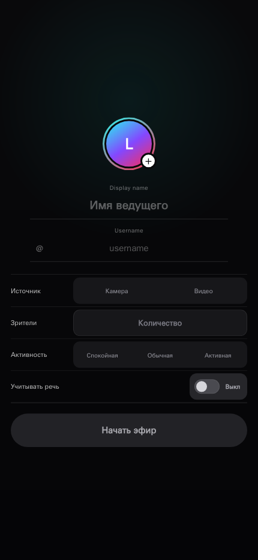

# Live Simulator

Симулятор вертикального прямого эфира. Показывает камеру или локальное видео, моделирует зрителей, лайки и реакции, распознаёт речь ведущего и создаёт контекстные комментарии.

## Возможности

- Камера или выбранное видео в мобильном live-интерфейсе.
- Настройки, аватар и видео сохраняются в браузере текущего устройства.
- Локальная аудитория со зрителями, реакциями, авторами и диалогами.
- Распознавание речи через Deepgram и комментарии с анализом кадра через Mistral.
- Подтверждение визуального наблюдения на следующем свежем кадре.
- Устанавливаемая PWA и доступная офлайн оболочка приложения.

Экран подготовки эфира:



## Установка и запуск

Нужны Docker с Compose v2 и BuildKit, домен, внешний HTTPS reverse proxy и собственные ключи Mistral/Deepgram. Контейнер API должен иметь доступ к HTTPS/WSS провайдеров.

Поддерживается только production-сборка. Development-сервер, HMR, bind mounts и development Compose-профиль не предусмотрены. Версии инструментов закреплены в [package.json](package.json), [lock-файле](pnpm-lock.yaml) и [Dockerfile](Dockerfile).

Скопируйте [.env.example](.env.example) в `.env` и заполните runtime-значения. Полный контракт, домен, TLS и WebSocket описаны в [развёртывании](docs/deployment.md). Ключи должны оставаться только у API, без попадания в Git, сборку и браузер.

```bash
docker compose -f compose.build.yaml config --quiet
docker compose -f compose.build.yaml build --pull
docker compose config --quiet
docker compose up -d --force-recreate --remove-orphans
```

Приложение публикуется на `127.0.0.1:18080`. Откройте настроенный HTTPS-домен после подключения внешнего Nginx. Остановка сохраняет named volumes:

```bash
docker compose down
```

## Использование

1. Задайте имя и аватар ведущего, выберите камеру или видео.
2. Укажите число зрителей и активность; при необходимости включите учёт речи.
3. Начните эфир. Просьба задавать вопросы создаёт одну ограниченную пачку из двух или трёх вопросов.
4. Для установки на iPhone откройте HTTPS-страницу в Safari и выберите **Поделиться**, затем **На экран "Домой"**.

Ответ ведущего связывается со зрителем только при однозначной адресации. Первое визуальное наблюдение остаётся предположением до подтверждения на следующем кадре. Приложение не угадывает плохо видимые предметы.

## Проверки

Основной изолированный контур выполняется при production-сборке:

```bash
docker compose -f compose.build.yaml build --pull
```

Сборка проверяет форматирование, ESLint без предупреждений, строгие типы, unit/component/API-тесты, зависимости и оба production-образа. Браузерные проверки и реальные smoke выполняются отдельно по [инструкции тестирования](docs/testing.md); smoke обращаются к Mistral и расходуют квоту.

## Ограничения

У API нет пользовательской аутентификации. Same-origin и rate limit не определяют владельца запроса. Если открытый расход провайдерской квоты недопустим, ограничьте доступ на внешнем reverse proxy.

Аватар, профиль и видео находятся в IndexedDB текущей пары браузер/origin. Встроенного экспорта нет; очистка данных сайта необратимо удалит их. API не сохраняет кадры, PCM-аудио, расшифровки, контекст и комментарии. Кадры и ограниченный контекст передаются Mistral, аудио передаётся Deepgram.

Система не измеряет качество аудио и не оценивает исправность микрофона. Deepgram Flux не выполняет разделение говорящих. Офлайн доступна оболочка; распознавание, анализ кадра и генерация требуют сети и действующих ключей.

## Документация

- [Архитектура](docs/architecture.md) и [модель данных](docs/data-model.md)
- [Развёртывание](docs/deployment.md) и [тестирование](docs/testing.md)
- [Текущее состояние](STATUS.md)
- [Участие в разработке](CONTRIBUTING.md), [безопасность](SECURITY.md) и [кодекс поведения](CODE_OF_CONDUCT.md)

## Лицензия

Код распространяется по [MIT License](LICENSE). Портреты в `src/assets/personas/portraits` используются по отдельному разрешению и не перелицензируются по MIT; источники перечислены в [LICENSES.json](src/assets/personas/LICENSES.json).

Проект не связан с TikTok. TikTok и связанные обозначения принадлежат соответствующим правообладателям.
